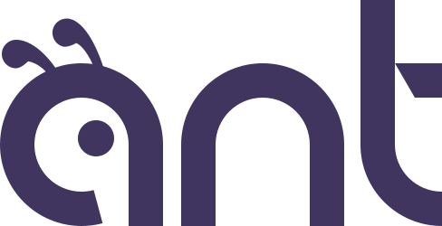

<p align="center">
  <picture>
    <source media="(prefers-color-scheme: dark)" srcset="docs/assets/logo-dark.svg">
    
  </picture>
</p>

<p align="center">
  A typed ORM for Go. Plain structs, compiler-checked queries, no code generation.
</p>

<p align="center">
  <a href="https://skudra.net">Documentation</a> ·
  <a href="https://skudra.net/quick-start">Quick start</a> ·
  <a href="https://github.com/skudra-go/ant-examples">Examples</a>
</p>

<p align="center">
  <a href="https://github.com/skudra-go/ant/actions/workflows/pr-ci.yml"></a>
  <a href="https://pkg.go.dev/github.com/skudra-go/ant"></a>
  
  <a href="LICENSE"></a>
</p>

---

Columns are field pointers, not strings. Write `ant.Gt(&U.Age, 18)` and the compiler checks both the column and the value. Rename a field and every query follows.

```go
type User struct {
    ant.Base // ID, CreatedAt, UpdatedAt
    Name     string
    Age      int
    Posts    []Post // 1:N through Post.UserID
}

type Post struct {
    ant.Base
    UserID int64
    Title  string
}

type AppDB struct {
    ant.Context
    Users ant.Table[User]
    Posts ant.Table[Post]
}

var U = ant.Fields[User]()

db, err := ant.Open[AppDB](ctx, postgres.Dialect, dsn)

adults, err := db.Users.
    Where(ant.Gt(&U.Age, 18)). // ant.Gt(&U.Age, "18") won't compile
    Include(&U.Posts).         // one batched query, not one per user
    All(ctx)

adults[0].Age++
err = db.SaveChanges(ctx) // writes only the columns that changed
```

## Install

```sh
go get github.com/skudra-go/ant
go get github.com/jackc/pgx/v5/stdlib  # or the driver for your database
```

Requires Go 1.27 or later, for generic methods.

## Features

- **Typed queries:** conditions, joins, projections, aggregates, subqueries, CTEs and window functions, all checked by the compiler
- **Plain structs:** your types are the models, with conventions you can override in `Configure`
- **Relations:** 1:1, 1:N and many-to-many, loaded explicitly with `Include`, in batches. Nothing loads behind your back
- **Change tracking:** load, edit, `SaveChanges`. Only the columns that changed are written
- **Writes:** insert, update, delete, upserts, `MERGE` and bulk writes, with a guard against unfiltered updates and deletes
- **Transactions:** savepoints, isolation levels, retries and read replicas
- **Lifecycle:** soft deletes, timestamps, global filters, hooks, validation and optimistic concurrency
- **Migrations:** plain SQL generated from your structs, with drift checks. No down migrations, and no lock-in
- **Tooling:** a `go vet` analyzer, query logging, metrics, OpenTelemetry, and test fixtures and factories in `anttest`

## Databases

| | PostgreSQL | MySQL | MariaDB | SQLite | SQL Server |
| --- | :---: | :---: | :---: | :---: | :---: |
| Queries and writes | ✅ | ✅ | ✅ | ✅ | ✅ |
| Migrations | ✅ | | | | |

PostgreSQL gets every feature first. [docs/databases.md](docs/databases.md) lists what each database lacks.

## Learn more

- [Documentation](https://skudra.net): guides, recipes and reference.
- [Feature examples](tests/features/): a short test for every feature, edge cases included
- [ant-examples](https://github.com/skudra-go/ant-examples): small projects built on ant
- [Roadmap](docs/ROADMAP.md) and [design decisions](docs/DECISIONS.md)

ant is pre-1.0, so the API can still change between releases.

## Contributing

Issues and pull requests are welcome. Read [CONTRIBUTING.md](CONTRIBUTING.md) first. Report vulnerabilities as [SECURITY.md](SECURITY.md) describes.

Thank you to everyone who has filed an issue, fixed a bug or improved the docs:

<a href="https://github.com/skudra-go/ant/graphs/contributors">
  
</a>

## About

*Skudra* means *ant* in Latvian, which is where [skudra.net](https://skudra.net) gets its name :)

## License

[MIT](LICENSE)
